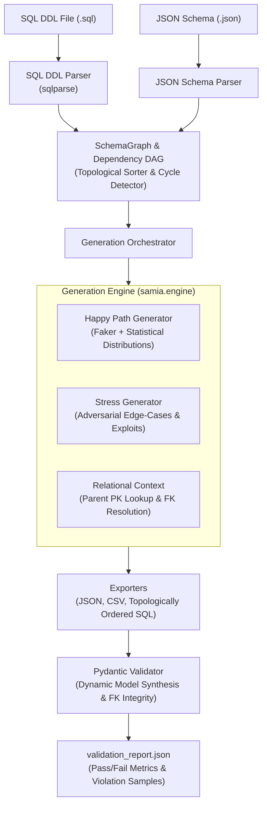

# Samia: AI Synthetic Test Data & Edge-Case Generator

[](https://www.python.org/downloads/)
[](https://opensource.org/licenses/MIT)
[](https://peps.python.org/pep-0484/)

**Samia** is an enterprise-grade AI Synthetic Test Data and Adversarial Edge-Case Generation Engine. It parses complex relational schemas (SQL DDL) and document specifications (JSON Schema), compiles a dependency DAG for topological generation order, produces realistic synthetic datasets with statistical distributions, injects adversarial edge cases, and rigorously validates outputs using dynamically synthesized Pydantic models.

---

## 🌟 Key Features

1. **Relational Schema Parsers (`samia.parsers`)**:
   - **SQL DDL (`sql_parser.py`)**: Uses `sqlparse` to extract tables, primary keys, composite keys, inline/table-level foreign keys, unique constraints, and check constraints (`BETWEEN`, `IN`, `>=`, `<=`). Computes a topological dependency DAG and detects circular dependencies.
   - **JSON Schema (`json_parser.py`)**: Parses standard JSON Schema specifications (Draft 4/7/2020-12) extracting types, min/max numbers, min/max string lengths, regex patterns, enums, formats, and nested arrays/objects.

2. **Dual-Strategy Generation Engine (`samia.engine`)**:
   - **Realistic Happy-Path (`generator_happy.py`)**: Uses `Faker` with semantic field detection (emails, names, addresses, phones, timestamps, UUIDs) and statistical distribution sampling:
     - **Normal (Gaussian)**: Truncated distributions for ages, metrics, scores.
     - **Log-Normal**: Heavy-tailed realistic modeling for transaction prices, balances, revenues.
     - **Uniform, Exponential, & Poisson**: Intervals, counts, and arrival rates.
     - **Categorical**: Weighted categorical choices for statuses and enum codes.
   - **Adversarial Stress Mutator (`generator_stress.py`)**: Injects high-risk edge cases and exploit payloads:
     - **Boundary Numbers**: `INT32_MAX`, `INT32_MIN`, `INT64_MAX`, `INT64_MIN`, `UINT_MAX`, `0`, `-1`, `1`, `NaN`, `±Inf`, subnormal floats (`1e-323`), precision overflows.
     - **Exploit Strings**: SQL Injection (`' OR '1'='1`, `'; DROP TABLE users; --`), XSS (`<script>alert(1)</script>`, ``), Template Injection (`{{7*7}}`, `${7*7}`).
     - **Unicode & Encodings**: Complex multi-codepoint ZWJ emojis (`👨‍👩‍👧‍👦`), Zalgo text, High-plane Unicode, Right-To-Left (RTL) override (`\u202E`), zero-width characters, null-byte injection (`test\x00user`), extreme-length strings (`4096+` chars).
     - **Temporal Edge Cases**: Unix Epoch (`1970-01-01`), Year 2038 rollover (`2038-01-19T03:14:07Z`), Leap years (`2000-02-29`, `2024-02-29`), non-leap century boundaries (`1900-02-28`), daylight saving gaps.
     - **Relational Integrity Preservation**: Injects stress data while preserving foreign key integrity by default so child records still properly link to parents.
   - **Topological Orchestrator (`orchestrator.py`)**: Manages relational execution order (e.g., `Users -> Orders -> Order_Items`), maintains a parent primary key pool (`RelationalContext`), and exports to **JSON**, **CSV**, and **topologically valid SQL INSERT statements**.

3. **Dynamic Pydantic Validator (`samia.validator`)**:
   - Dynamically synthesizes Pydantic v2 `BaseModel` classes from table metadata at runtime.
   - Validates types, NOT NULL rules, numeric ranges, string length boundaries, regex patterns, enum sets, dataset-wide unique constraints, and foreign key referential integrity.
   - Produces a structured `validation_report.json` tracking pass/fail metrics, table breakdowns, and violation examples.

4. **Rich CLI & Configuration System (`samia.cli`)**:
   - Complete command-line interface with `generate`, `inspect`, and `validate` commands.
   - Rich terminal tables, colorized progress, and `samia_config.yaml` support.

---

## 🏗️ Architecture



---

## 🚀 Installation

Ensure Python 3.10+ is installed:

```bash
# Clone the repository
git clone https://github.com/your-org/samia.git
cd samia

# Create and activate virtual environment
python -m venv .venv
source .venv/bin/activate  # On Windows: .venv\Scripts\activate

# Install dependencies and package in editable mode
pip install -r requirements.txt
pip install -e .
```

---

## ⚡ Quickstart

### 1. Inspect Schema & Dependency DAG

Inspect SQL DDL tables, types, constraints, and topological order:

```bash
samia inspect --schema-sql examples/ecommerce.sql
```

Inspect JSON Schema fields, rules, and formats:

```bash
samia inspect --schema-json examples/user_event.json
```

### 2. Generate Synthetic Datasets

Generate 100% valid realistic records across relational tables:

```bash
samia generate --schema-sql examples/ecommerce.sql --mode happy --count 20 --format all
```

Generate adversarial stress-testing data with edge cases:

```bash
samia generate --schema-sql examples/ecommerce.sql --mode stress --count 20
```

Generate a mixed dataset (e.g. 80% realistic, 20% stress) using a config file:

```bash
samia generate --config samia_config.yaml
```

### 3. Validate Existing Datasets

Validate an existing synthetic JSON dataset against schema constraints:

```bash
samia validate --data output/synthetic_data.json --schema-sql examples/ecommerce.sql --report output/report.json
```

---

## ⚙️ Configuration (`samia_config.yaml`)

You can control all generation and validation parameters using a configuration file:

```yaml
version: "1.0"
project: "Samia AI Synthetic Test Data & Edge-Case Generator"

generation:
  mode: "mixed"            # options: happy, stress, mixed
  seed: 42                 # seed for deterministic repeatability
  default_count: 15        # default row count per table
  mutation_rate: 0.35      # field-level mutation probability during stress testing
  mixed_stress_ratio: 0.20 # fraction of records mutated in mixed mode (20%)

schema:
  type: "sql"              # options: sql, json
  path: "examples/ecommerce.sql"

# Custom per-table generation row counts
tables:
  users:
    count: 20
  categories:
    count: 5
  products:
    count: 25
  orders:
    count: 40
  order_items:
    count: 80
  reviews:
    count: 30

output:
  directory: "output"
  formats: ["json", "csv", "sql"]

validation:
  enabled: true
  report_path: "output/validation_report.json"
```

---

## 🐍 Programmatic Python API

You can also use Samia directly within Python code or test suites:

```python
from samia.parsers.sql_parser import SQLDDLParser
from samia.engine.orchestrator import GenerationOrchestrator, GenerationMode
from samia.validator.pydantic_validator import PydanticValidator

# 1. Parse SQL DDL schema
parser = SQLDDLParser()
graph = parser.parse_file("examples/ecommerce.sql")

# Inspect generation order
print("Generation Order:", graph.get_topological_order())
# Output: ['users', 'categories', 'orders', 'products', 'order_items', 'reviews']

# 2. Orchestrate multi-table generation
orchestrator = GenerationOrchestrator(schema_graph=graph, seed=42)
result = orchestrator.generate(
    mode=GenerationMode.MIXED,
    default_count=10,
    mutation_rate=0.3,
)

# 3. Export generated data
result.export_json("output/synthetic_data.json")
result.export_csv_dir("output/csv/")
result.export_sql_inserts("output/inserts.sql")

# 4. Validate constraints with Pydantic
validator = PydanticValidator(schema_graph=graph)
report = validator.validate_dataset(
    dataset=result.data,
    output_report_path="output/validation_report.json",
)

print(f"Validation Pass Rate: {report.pass_rate:.2f}%")
```

---

## 📊 Structured Validation Report (`validation_report.json`)

When validation is enabled, Samia records full diagnostic metrics and violation samples:

```json
{
  "summary": {
    "total_records": 200,
    "valid_records": 164,
    "invalid_records": 36,
    "pass_rate_percentage": 82.0,
    "duration_seconds": 0.0518
  },
  "tables": {
    "users": {
      "table_name": "users",
      "total_records": 20,
      "valid_records": 19,
      "invalid_records": 1,
      "pass_rate_percentage": 95.0,
      "violations_by_column": {
        "username": 1
      },
      "violations_by_rule": {
        "string_too_long": 1
      },
      "sample_violations": [
        {
          "table_name": "users",
          "row_index": 19,
          "column_name": "username",
          "rule": "string_too_long",
          "value": "1' UNION SELECT NULL, username, password FROM users --",
          "message": "String should have at most 50 characters"
        }
      ]
    }
  }
}
```

---

## 🧪 Testing

Run the test suite with `pytest`:

```bash
pytest -v
```

All 16 test suites verify:
- SQL DDL parsing, constraints, and DAG cycle detection
- JSON Schema Draft 7/2020-12 parsing and model conversion
- Statistical distributions (Normal, Log-normal, Uniform, Categorical)
- Happy path data generation and determinism
- Adversarial edge-case injection (INT_MAX, SQLi, XSS, Unicode, Dates)
- Topological generation order and foreign key resolution
- Dynamic Pydantic validator constraint enforcement
- CLI entrypoints and config loading

---

## 📄 License

This project is licensed under the MIT License - see the LICENSE file for details.
